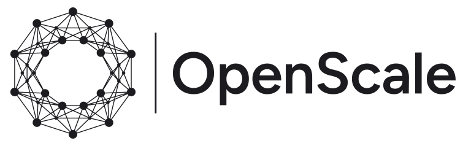
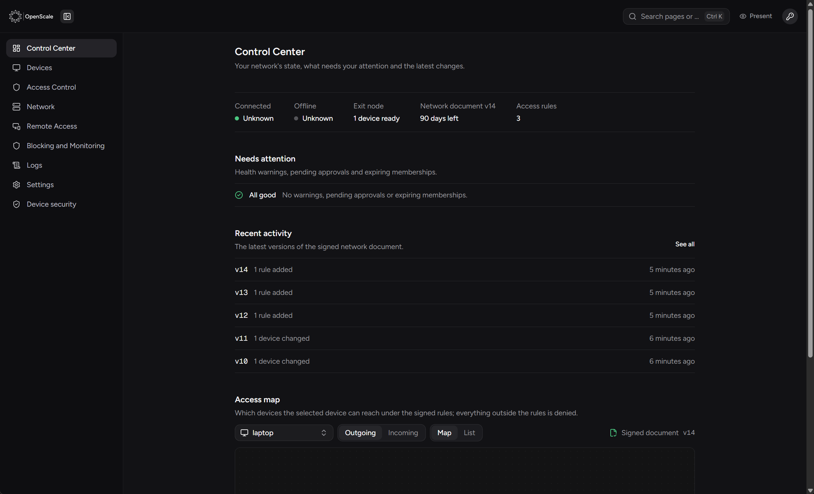
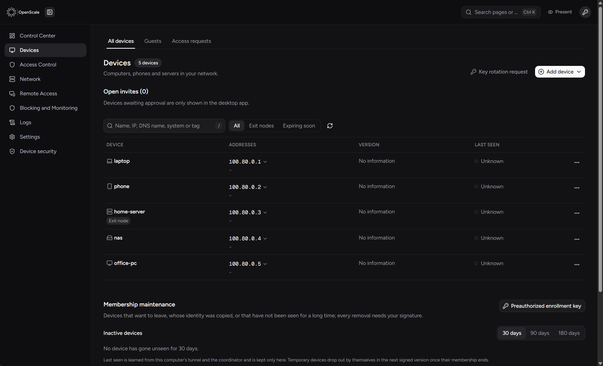
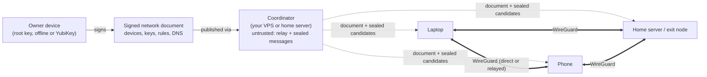

<p align="center">
  
</p>

<p align="center">
  <picture>
    <source media="(prefers-color-scheme: dark)" srcset="logos/openscale-logo-dark.svg">
    
  </picture>
</p>

<p align="center">
  <strong>A personal, self-hosted, privacy-first WireGuard mesh VPN.</strong><br>
  No accounts. No cloud. No telemetry. Your keys, your server, your devices.
</p>

<p align="center">
  <a href="https://github.com/LLCForge/OpenScale/releases"></a>
  <a href="https://github.com/LLCForge/OpenScale/actions/workflows/ci.yml"></a>
  <a href="LICENSE"></a>
  
  
</p>

<p align="center">
  <b>English</b> · <a href="README.tr.md">Türkçe</a>
</p>

---

OpenScale connects **one owner's** laptops, desktops, phones, home servers and VPSes into a private network. Every device reaches every other device by name (`desktop.openscale.internal`) over an end-to-end encrypted WireGuard tunnel, from any network, without opening ports on the devices and without trusting any company in between.

It is built for people who want what Tailscale or NetBird offer, but with **nothing outside their own control**: the coordinator runs on your own server, the network is defined by a document signed with a root key that only you hold, and a compromised server cannot add devices, change rules, open remote sessions or read traffic.

<p align="center">
  
</p>

> **Status:** beta (`1.0.0-beta.x`). The core is feature complete and tested; expect rough edges on some platforms. See the [changelog](CHANGELOG.md) and the [security policy](SECURITY.md).

## Table of contents

- [Why OpenScale](#why-openscale)
- [Features](#features)
- [Screenshots](#screenshots)
- [How it works](#how-it-works)
- [Security model](#security-model)
- [Platforms](#platforms)
- [Installation](#installation)
- [Everyday use](#everyday-use)
- [Desktop apps](#desktop-apps)
- [Updates and releases](#updates-and-releases)
- [Troubleshooting](#troubleshooting)
- [Building from source](#building-from-source)
- [Contributing](#contributing)
- [License](#license)

## Why OpenScale

| | OpenScale |
|---|---|
| **Who controls the network** | Only you. Membership and rules live in a document signed by your root key (Ed25519, kept offline or on a YubiKey). |
| **What the server can do** | Relay encrypted packets and pass sealed messages between devices. It cannot add a device, change a rule, grant remote access or decrypt traffic, even when fully compromised. It cannot even read the devices' connection candidates. |
| **Accounts and cloud** | None. No sign-up, no identity provider, no hosted control plane, no external STUN, DNS or relay. |
| **Telemetry** | None. The program contains no outside address it could report to. |
| **Cryptography** | Standard, audited primitives: WireGuard, Ed25519, X25519, XChaCha20-Poly1305, Argon2id, plus a hybrid post-quantum pre-shared key (ML-KEM-768) per peer pair. |
| **Dependencies** | Go standard library, `golang.org/x/*`, `wireguard-go` and `wazero`. |

## Features

**Networking**
- Full mesh WireGuard with direct connections through NAT: UDP hole punching, UPnP-IGD / NAT-PMP / PCP, port prediction and a bounded birthday scan for symmetric NATs, with an encrypted relay fallback over UDP, TCP/443 or a TLS-camouflaged transport.
- Connection candidates are sealed end to end between devices, so the coordinator never sees them.
- Seamless upgrade from relay to direct paths, fast reconnect on network changes, sleep and wake handling.
- Exit nodes with kill switch (Windows WFP, Linux nftables, macOS pf), boot-time kill switch, IPv6 and DNS leak protection and a built-in leak test.
- Subnet routers for devices that cannot run OpenScale (printers, NAS, cameras), with IoT and camera isolation templates.
- Keeps working when the coordinator is down: devices use their last known paths and gossip the signed document.

**DNS**
- MagicDNS names from the signed document, split DNS, search domains and short names.
- Built-in recursive resolver with DNSSEC and QNAME minimisation, or forwarding to your own DoH/DoT resolver.
- Network-wide ad and tracker blocking from lists you load yourself, DNS leak guard, DoH-bypass detection.

**Access control**
- Default-deny, stateful packet filter on every device, between WireGuard and the TUN interface.
- Direction-aware rules by device, tag, group, IP/CIDR range and protocol; `policy check` and lint before signing.
- Intrusion detection and quarantine in the packet filter.

**Remote access and files**
- Built-in remote desktop without a broker: the target confirms each session, multi-monitor view, a second admin can join as a viewer, unattended access is a separate signed permission. Works on Windows, macOS, Linux X11 and Wayland.
- Embedded SSH server, short-lived SSH certificates issued by the root key, an in-app SSH terminal and an SFTP file browser.
- Remote support toolbox: processes, services, event logs and disk usage of a device, read only, with the user's consent.
- End-to-end encrypted file transfer (even the coordinator cannot see names or contents), "Send to OpenScale" in Explorer, accept files from a notification, folder sync, Wake-on-LAN.
- Network shares of your devices appear automatically under **Network locations** in Windows Explorer.

**Administration**
- Desktop apps for Windows, macOS and Linux with tray / menu bar icon and automatic sign-in to the panel.
- The panel speaks **English and Turkish**; switch at any time in Settings.
- Admin mode from any device with a YubiKey (PIV) or a password, delegated admin keys, emergency lockdown.
- Invites with a 4-digit confirmation code, pre-authorised keys for headless servers, QR enrolment, device retirement wizard.
- Troubleshooting wizard that tests interface, gateway, DNS, coordinator, relay and every peer in order; a flight recorder that keeps the last 30 minutes of masked logs for intermittent drops.
- Encrypted, hash-chained local audit log, health monitoring, desktop notifications, webhooks to your own endpoints, WebAssembly plugins.

## Screenshots

| Control Center | Devices |
|---|---|
|  |  |

Taken from a demo network with made-up device names.

## How it works



1. **The owner** creates a network once (`openscale network init`). This generates the root key, protected with Argon2id or stored on a YubiKey.
2. **Every change** (a device, a rule, a DNS record) produces a new version of the network document, signed by the root key. Devices refuse anything unsigned, older than what they have, or with fields they do not know.
3. **The coordinator** is a single UDP port on a server you control. It distributes the document, forwards sealed messages between devices and relays packets when no direct path exists. It never holds a key that matters.
4. **Devices** verify the document, configure WireGuard, enforce the rules locally and talk to each other directly whenever possible.

## Security model

- **Trust root:** an Ed25519 root key held only by the owner. All authority flows from documents it signs.
- **Compromised coordinator:** cannot enrol devices, change rules, grant admin rights, open remote desktop, SSH or support sessions, read connection candidates or traffic. It can at most deny service, which devices survive by working peer to peer. RDP and SSH on Windows are limited to the tunnel by default.
- **Compromised device:** revoked with one signed document; peers drop it immediately.
- **Untrusted input:** network documents and release manifests from the network are parsed in a separate, unprivileged helper process (low integrity on Windows, Landlock and seccomp on Linux).
- **Releases:** signed manifests with a separate release root key, revocable signing keys, rollback protection, reproducible builds and staged rollout rings.
- **Hardening:** sandboxing, no core dumps, locked memory for secrets, AppArmor and SELinux profiles (in `deploy/linux`), fail-closed defaults.

Please report vulnerabilities privately as described in [SECURITY.md](SECURITY.md).

## Platforms

Every release is built automatically for **Windows, Linux and macOS** and published on the [releases page](https://github.com/LLCForge/OpenScale/releases).

| Platform | Role | Download |
|---|---|---|
| Windows 10/11 (x64) | Device, admin, desktop app (window + tray) | `openscale-<version>-windows-amd64.zip` |
| macOS 12+ (Intel and Apple silicon) | Device, admin, menu bar app | `OpenScale-<version>.dmg` |
| Linux (amd64, arm64, armv7) | Device, coordinator, exit node, subnet router, tray app | `.deb`, `.rpm`, `.tar.gz` |
| Raspberry Pi OS | Device, exit node, relay | `.deb` (arm64 / armhf) |
| FreeBSD, pfSense, OPNsense | Device (tunnel only) | `openscale-<version>-freebsd-*.tar.gz` |
| Android | Coming soon | |
| iOS | Coming soon | |

> **Mobile apps:** native Android and iOS apps are under development and will be released soon.

Ready-made recipes live in [`deploy/`](deploy/): Docker and Podman, Kubernetes (sidecar), OpenWrt, NixOS, Arch (PKGBUILD), Fedora (spec), immutable distributions (Silverblue, MicroOS, SteamOS / Steam Deck), MikroTik RouterOS 7 container, Home Assistant OS add-on, Qubes OS network qube, pfSense and OPNsense plugin skeletons, AppArmor and SELinux profiles.

## Installation

> Commands use placeholder names. Every command prints its options with `--help`.

### 1. Create your network

On the computer that will hold the root key (your main computer, or an offline one):

```bash
openscale network init --dir ./my-network
```

You choose a passphrase for the root key, and the setup asks you to write a backup to a USB stick. **Keep that backup**: without the root key nobody, including you, can change the network. A YubiKey can hold the root key instead (`openscale key` commands).

### 2. Set up a coordinator

Any small Linux server you control works (a VPS with 1 vCPU and 512 MB RAM is plenty); a home server works too, with one UDP port forwarded. Only one UDP port (default `41820`) is exposed.

```bash
sudo apt install ./openscale_<version>_amd64.deb      # or the .rpm / .tar.gz
sudo openscale service install --role coordinator
```

The service runs hardened (systemd sandbox, Landlock, no core dumps). Point the network at it from the admin computer:

```bash
openscale network set-coordinator --dir ./my-network --endpoint vpn.example.com:41820
```

### 3. Install the desktop app

- **Windows:** unzip the release and run `install-windows.ps1` (it verifies the release before installing). The app installs a service, adds a tray icon and shortcuts, and starts at sign-in.
- **macOS:** open the `.dmg` and drag OpenScale to Applications. On first start it asks for your password once to install the background service.
- **Linux desktop:** install the package, then `openscale tray`; it can install the background service with a polkit prompt.

### 4. Add devices

In the panel open *Devices → Add device → Invite*, or on the admin computer:

```bash
openscale invite create --dir ./my-network --hours 1
```

On the new device:

```bash
sudo openscale invite-join --code @invite.txt --state-dir /var/lib/openscale/device
sudo openscale service install --role device
```

The device shows a 4-digit code; approve the request in the panel when the same code appears there. For headless servers a pre-authorised key skips the approval: `openscale device preauth` on the admin computer, `openscale preauth-join` on the server.

## Everyday use

| Task | Panel | Command line |
|---|---|---|
| See every device and its path | *Devices* | `openscale status` |
| Allow access between devices | *Access Control → Rules* | `openscale rule add --from laptop --to nas --proto tcp --ports 445` |
| Use a device as exit node | *Devices → ⋯ → Exit node* | `openscale up --exit-node home-server` |
| Remote desktop | *Remote Access* | `openscale rdesk connect desktop` |
| SSH terminal and files | *Remote Access → Terminal / Files* | `openscale ssh admin@home-server` |
| Send a file | *Transfer*, or *Send to → OpenScale* in Explorer | `openscale send report.pdf laptop` |
| Forward a local port | | `openscale forward 8080 nas:80` |
| Check what is wrong | *Diagnostics → Find the connection problem* | `openscale troubleshoot` |
| Revoke a lost device | *Devices → ⋯ → Retire* | `openscale device retire --name phone` |

## Desktop apps

- **Windows:** native window (WebView2) and tray icon. Closing the window keeps OpenScale in the tray; a left click shows a small status flyout and **Open panel** signs you in automatically. Starts at sign-in without a consent prompt, adds Start menu and desktop shortcuts, follows the light or dark theme.
- **macOS:** menu bar app with a native window, installed as a launchd service, starts at login.
- **Linux:** tray icon through StatusNotifierItem (KDE, GNOME with AppIndicator, XFCE, Cinnamon), panel in a WebKitGTK window or the browser.

## Updates and releases

- Every change that ships bumps [`VERSION`](VERSION) (`1.0 → 1.1 → … → 1.9 → 2.0`; betas as `-beta.N`) and gets an entry in the [changelog](CHANGELOG.md).
- A new `VERSION` on `main` triggers the [release workflow](.github/workflows/release.yml): Windows, Linux, macOS and FreeBSD binaries, the macOS app (`.dmg`), `.deb`/`.rpm` packages, an SPDX SBOM and `SHA256SUMS` are built and published as a GitHub release.
- **Automatic updates:** the coordinator can follow this repository's releases (`openscale update source set https://github.com/LLCForge/OpenScale`), verify them and offer them to devices over the tunnel; devices never contact GitHub themselves. Devices install only releases signed with the owner's release key, in rings (`ring-canary` → `ring-early` → everyone) that stop automatically if a device rolls back. The tunnel stays up during the update. Turn it off per device with `openscale update auto off` (status: `openscale update auto status`).
- **Signing your releases:** create a release root key and a signing key once (`releasesign root-keygen`, `signing-keygen`, `certify`, built from `cmd/releasesign`), then build without `--unsigned`. Unsigned builds are published for transparency but are never installed automatically.
- Builds are reproducible: `scripts/reproduce.sh --manifest openscale-<version>.release.json` rebuilds a release byte for byte, and `scripts/verify-release.sh` checks a download.

## Troubleshooting

- **Run the wizard first:** *Diagnostics → Find the connection problem* (or `openscale troubleshoot`) tests each layer and says what to fix.
- **Every error has a stable code** (`OS-1002`, `OS-3001`, …); `openscale explain <code>` prints the cause and the fix.
- **Another VPN on the same machine:** Tailscale drops the `100.64.0.0/10` range on other interfaces. OpenScale warns at start and prints the exact exception (`iptables -I ts-input 1 -i OpenScale -j ACCEPT`).
- **Host firewalls:** firewalld, ufw and nftables policies that would block the tunnel are detected; the fix is printed (firewalld is adjusted for the current run only).
- **Intermittent drops:** *Diagnostics → Save the last drop* freezes the flight recorder into an encrypted, masked bundle you can share.

## Building from source

Requirements: Go 1.26+, Node.js 22+ and pnpm 10+ for the panel. On Linux the optional native parts need `libpcsclite-dev` (YubiKey), `libpipewire-0.3-dev` (Wayland) and `libwebkit2gtk-4.1-dev` (panel window); without cgo they fall back gracefully.

```bash
pnpm --dir panel install --frozen-lockfile
pnpm --dir panel build
go build -trimpath -o bin/openscale ./cmd/openscale
```

A full release (all platforms, packages, checksums, optional signing):

```bash
bash scripts/release.sh --unsigned
```

## Contributing

Issues and pull requests are welcome. Please:

- keep the project's principles: no telemetry, no third-party services, an untrusted coordinator, minimal dependencies;
- add tests for every change and keep CI green (`go vet ./...`, `go test ./...`, `pnpm --dir panel lint typecheck build`);
- add both English and Turkish text for anything shown in the panel;
- never include real keys, network documents, addresses or personal data in issues, tests or commits.

## License

OpenScale is released under the [MIT License](LICENSE). Bundled third-party components (such as the Wintun driver) keep their own licenses; see the *About* page in the app.
