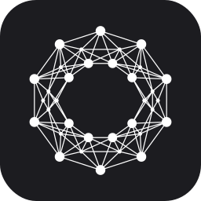
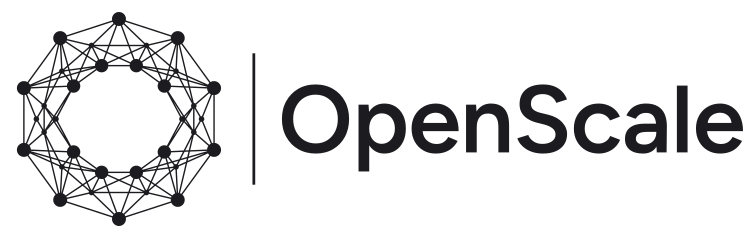
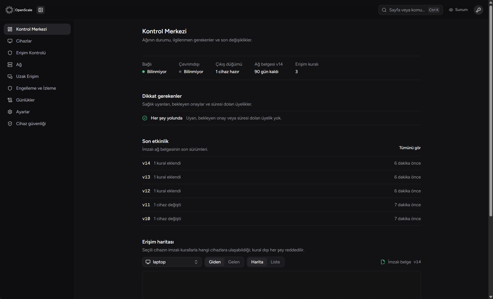
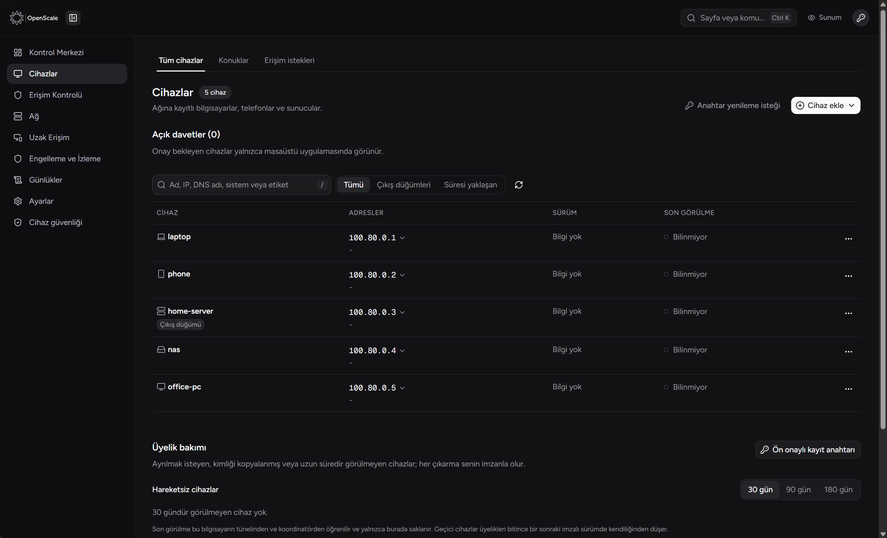
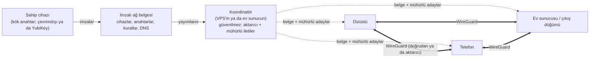

<p align="center">
  
</p>

<p align="center">
  <picture>
    <source media="(prefers-color-scheme: dark)" srcset="logos/openscale-logo-dark.svg">
    
  </picture>
</p>

<p align="center">
  <strong>Kişisel, kendi sunucunda çalışan, gizlilik öncelikli WireGuard mesh VPN.</strong><br>
  Hesap yok. Bulut yok. Telemetri yok. Anahtarlar, sunucu ve cihazlar senin.
</p>

<p align="center">
  <a href="https://github.com/LLCForge/OpenScale/releases"></a>
  <a href="https://github.com/LLCForge/OpenScale/actions/workflows/ci.yml"></a>
  <a href="LICENSE"></a>
  
  
</p>

<p align="center">
  <a href="README.md">English</a> · <b>Türkçe</b>
</p>

---

OpenScale **tek bir sahibin** dizüstü, masaüstü, telefon, ev sunucusu ve VPS'lerini özel bir ağda birleştirir. Her cihaz diğerine adıyla (`masaustu.openscale.internal`) uçtan uca şifreli bir WireGuard tüneliyle, her ağdan, cihazlarda port açmadan ve aradaki hiçbir şirkete güvenmeden ulaşır.

Tailscale veya NetBird'ün sunduklarını isteyen ama **kendi denetimi dışında hiçbir şey** istemeyenler için yapıldı: koordinatör senin sunucunda çalışır, ağ yalnızca sende olan bir kök anahtarla imzalanmış belgeyle tanımlanır; ele geçirilmiş bir sunucu cihaz ekleyemez, kural değiştiremez, uzak oturum açamaz, trafiği okuyamaz.

<p align="center">
  
</p>

> **Durum:** beta (`1.0.0-beta.x`). Çekirdek tamam ve test edildi; bazı platformlarda pürüzler olabilir. [Değişiklik günlüğüne](CHANGELOG.md) ve [güvenlik politikasına](SECURITY.md) bak.

## İçindekiler

- [Neden OpenScale](#neden-openscale)
- [Özellikler](#özellikler)
- [Ekran görüntüleri](#ekran-görüntüleri)
- [Nasıl çalışır](#nasıl-çalışır)
- [Güvenlik modeli](#güvenlik-modeli)
- [Platformlar](#platformlar)
- [Kurulum](#kurulum)
- [Günlük kullanım](#günlük-kullanım)
- [Masaüstü uygulamaları](#masaüstü-uygulamaları)
- [Güncellemeler ve sürümler](#güncellemeler-ve-sürümler)
- [Sorun giderme](#sorun-giderme)
- [Kaynaktan derleme](#kaynaktan-derleme)
- [Katkı](#katkı)
- [Lisans](#lisans)

## Neden OpenScale

| | OpenScale |
|---|---|
| **Ağı kim yönetir** | Yalnızca sen. Üyelik ve kurallar kök anahtarınla (Ed25519; çevrimdışı ya da YubiKey'de) imzalanmış bir belgede durur. |
| **Sunucu ne yapabilir** | Şifreli paketleri aktarır ve cihazlar arasında mühürlü iletileri taşır. Tamamen ele geçirilse bile cihaz ekleyemez, kural değiştiremez, uzak erişim veremez, trafiği çözemez; cihazların bağlantı adaylarını bile okuyamaz. |
| **Hesap ve bulut** | Yok. Kayıt, kimlik sağlayıcı, barındırılan kontrol düzlemi, dış STUN, DNS veya aktarıcı yok. |
| **Telemetri** | Yok. Programın içinde rapor gönderebileceği tek bir dış adres bile yok. |
| **Kriptografi** | Yalnızca standart ve denetlenmiş yapı taşları: WireGuard, Ed25519, X25519, XChaCha20-Poly1305, Argon2id ve her eş çifti için hibrit kuantum sonrası ön paylaşımlı anahtar (ML-KEM-768). |
| **Bağımlılıklar** | Go standart kütüphanesi, `golang.org/x/*`, `wireguard-go` ve `wazero`. |

## Özellikler

**Ağ**
- NAT arkasından doğrudan bağlantılı tam mesh WireGuard: UDP delik delme, UPnP-IGD / NAT-PMP / PCP, port tahmini ve simetrik NAT için sınırlı doğum günü taraması; olmazsa UDP, TCP/443 veya TLS taklitli taşıma üzerinden şifreli aktarıcı.
- Bağlantı adayları cihazlar arasında uçtan uca mühürlüdür; koordinatör bunları göremez.
- Aktarıcıdan doğrudan yola kesintisiz geçiş, ağ değişince hızlı yeniden bağlanma, uyku ve uyanma yönetimi.
- Kill switch'li çıkış düğümleri (Windows WFP, Linux nftables, macOS pf), açılışta kill switch, IPv6 ve DNS sızıntı koruması ve yerleşik sızıntı testi.
- OpenScale kurulamayan cihazlar (yazıcı, NAS, kamera) için alt ağ yönlendirici; IoT ve kamera yalıtım şablonları.
- Koordinatör kapalıyken de çalışır: cihazlar son bilinen yolları kullanır ve imzalı belgeyi birbirine yayar.

**DNS**
- İmzalı belgeden MagicDNS adları, bölünmüş DNS, arama alanları ve kısa adlar.
- DNSSEC ve QNAME küçültmeli yerleşik özyinelemeli çözücü ya da kendi DoH/DoT çözücüne iletim.
- Kendi yüklediğin listelerle ağ genelinde reklam ve izleyici engelleme, DNS sızıntı koruması, DoH atlatma tespiti.

**Erişim denetimi**
- Her cihazda, WireGuard ile TUN arayüzü arasında varsayılan olarak reddeden, durum takipli paket süzgeci.
- Cihaz, etiket, grup, IP/CIDR aralığı ve protokole göre yön bilen kurallar; imzalamadan önce `policy check` ve lint.
- Paket süzgecinde saldırı tespiti ve karantina.

**Uzak erişim ve dosyalar**
- Aracı sunucusuz yerleşik uzak masaüstü: hedef her oturumu onaylar, çoklu monitör görünümü, ikinci bir yönetici izleyici olarak katılabilir, gözetimsiz erişim ayrı bir imzalı izindir. Windows, macOS, Linux X11 ve Wayland'de çalışır.
- Gömülü SSH sunucusu, kök anahtarın verdiği kısa ömürlü SSH sertifikaları, uygulama içi SSH terminali ve SFTP dosya gezgini.
- Uzaktan destek araç kutusu: bir cihazın süreçleri, hizmetleri, olay günlükleri ve disk doluluğu; salt okunur ve kullanıcının onayıyla.
- Uçtan uca şifreli dosya aktarımı (koordinatör bile dosya adını ve içeriğini göremez), Gezgin'de "OpenScale ile gönder", bildirimden dosya kabulü, klasör eşitleme, Wake-on-LAN.
- Cihazlarının ağ paylaşımları Windows Gezgini'nde **Ağdaki konumlar** altında kendiliğinden görünür.

**Yönetim**
- Windows, macOS ve Linux için tepsi / menü çubuğu simgeli ve panele otomatik giriş yapan masaüstü uygulamaları.
- Panel **Türkçe ve İngilizce** konuşur; Ayarlar'dan istediğin zaman değiştir.
- Herhangi bir cihazdan YubiKey (PIV) veya parolayla yönetici kipi, yetki devredilmiş yönetici anahtarları, acil durum kilidi.
- 4 haneli onay kodlu davetler, ekransız sunucular için ön onaylı anahtarlar, QR ile kayıt, cihaz emekliye ayırma sihirbazı.
- Arayüz, ağ geçidi, DNS, koordinatör, aktarıcı ve her eşi sırayla deneyen arıza ayıklayıcı; aralıklı kopmalar için son 30 dakikanın maskeli günlüğünü tutan uçuş kaydedici.
- Şifreli, hash zincirli yerel denetim kaydı, sağlık izleme, masaüstü bildirimleri, kendi uç noktalarına webhook'lar, WebAssembly eklentileri.

## Ekran görüntüleri

| Kontrol Merkezi | Cihazlar |
|---|---|
|  |  |

Uydurma cihaz adlarıyla kurulmuş bir deneme ağından alınmıştır.

## Nasıl çalışır



1. **Sahip** ağı bir kez oluşturur (`openscale network init`). Kök anahtar üretilir; Argon2id ile korunur ya da YubiKey'de saklanır.
2. **Her değişiklik** (cihaz, kural, DNS kaydı) ağ belgesinin kök anahtarla imzalanmış yeni bir sürümünü üretir. Cihazlar imzasız, elindekinden eski ya da tanımadığı alan taşıyan belgeyi reddeder.
3. **Koordinatör** senin sunucunda tek bir UDP portudur. Belgeyi dağıtır, cihazlar arasında mühürlü iletileri taşır ve doğrudan yol yoksa paketleri aktarır. Önemli hiçbir anahtar onda değildir.
4. **Cihazlar** belgeyi doğrular, WireGuard'ı kurar, kuralları yerelde uygular ve mümkün olan her durumda birbirleriyle doğrudan konuşur.

## Güvenlik modeli

- **Güven kökü:** yalnızca sahipte olan Ed25519 kök anahtar. Bütün yetki onun imzaladığı belgelerden gelir.
- **Ele geçirilmiş koordinatör:** cihaz kaydedemez, kural değiştiremez, yönetici yetkisi veremez, uzak masaüstü, SSH veya destek oturumu açamaz, bağlantı adaylarını ya da trafiği okuyamaz. En fazla hizmeti engelleyebilir; cihazlar bunu eşler arası çalışarak atlatır. Windows'ta RDP ve SSH varsayılan olarak yalnızca tünelden açıktır.
- **Ele geçirilmiş cihaz:** tek bir imzalı belgeyle iptal edilir; eşler onu hemen düşürür.
- **Güvenilmeyen girdi:** ağdan gelen belgeler ve sürüm manifestoları ayrı, yetkisiz bir yardımcı süreçte ayrıştırılır (Windows'ta düşük bütünlük, Linux'ta Landlock ve seccomp).
- **Sürümler:** ayrı bir sürüm kök anahtarıyla imzalı manifestolar, iptal edilebilir imzalama anahtarları, geri alma koruması, tekrarlanabilir derlemeler ve aşamalı dağıtım halkaları.
- **Sertleştirme:** kum havuzu, çekirdek dökümü yok, sırlar için kilitli bellek, AppArmor ve SELinux profilleri (`deploy/linux`), hata durumunda kapalı varsayılanlar.

Güvenlik açıklarını [SECURITY.md](SECURITY.md) dosyasında anlatıldığı gibi gizli olarak bildir.

## Platformlar

Her sürüm **Windows, Linux ve macOS** için otomatik derlenir ve [sürümler sayfasında](https://github.com/LLCForge/OpenScale/releases) yayımlanır.

| Platform | Rol | İndirme |
|---|---|---|
| Windows 10/11 (x64) | Cihaz, yönetici, masaüstü uygulaması (pencere + tepsi) | `openscale-<sürüm>-windows-amd64.zip` |
| macOS 12+ (Intel ve Apple silicon) | Cihaz, yönetici, menü çubuğu uygulaması | `OpenScale-<sürüm>.dmg` |
| Linux (amd64, arm64, armv7) | Cihaz, koordinatör, çıkış düğümü, alt ağ yönlendirici, tepsi uygulaması | `.deb`, `.rpm`, `.tar.gz` |
| Raspberry Pi OS | Cihaz, çıkış düğümü, aktarıcı | `.deb` (arm64 / armhf) |
| FreeBSD, pfSense, OPNsense | Cihaz (yalnızca tünel) | `openscale-<sürüm>-freebsd-*.tar.gz` |
| Android | Yakında | |
| iOS | Yakında | |

> **Mobil uygulamalar:** Android ve iOS uygulamaları geliştiriliyor, yakında yayımlanacak.

Hazır tarifler [`deploy/`](deploy/) altında: Docker ve Podman, Kubernetes (yan konteyner), OpenWrt, NixOS, Arch (PKGBUILD), Fedora (spec), değişmez dağıtımlar (Silverblue, MicroOS, SteamOS / Steam Deck), MikroTik RouterOS 7 konteyneri, Home Assistant OS eklentisi, Qubes OS ağ qube'u, pfSense ve OPNsense eklenti iskeletleri, AppArmor ve SELinux profilleri.

## Kurulum

> Komutlarda örnek adlar kullanılır. Her komut seçeneklerini `--help` ile gösterir.

### 1. Ağını oluştur

Kök anahtarı tutacak bilgisayarda (ana bilgisayarın ya da çevrimdışı bir bilgisayar):

```bash
openscale network init --dir ./benim-agim
```

Kök anahtar için bir parola seçersin ve kurulum bir USB belleğe yedek almanı ister. **O yedeği sakla**: kök anahtar olmadan sen dahil kimse ağı değiştiremez. İstersen kök anahtar YubiKey'de de durabilir (`openscale key` komutları).

### 2. Koordinatörü kur

Denetimindeki herhangi bir küçük Linux sunucu olur (1 vCPU ve 512 MB RAM'li bir VPS fazlasıyla yeter); tek bir UDP portu yönlendirilmiş ev sunucusu da olur. Dışarı yalnızca bir UDP portu (varsayılan `41820`) açılır.

```bash
sudo apt install ./openscale_<sürüm>_amd64.deb      # ya da .rpm / .tar.gz
sudo openscale service install --role coordinator
```

Servis sertleştirilmiş çalışır (systemd kum havuzu, Landlock, çekirdek dökümü yok). Yönetici bilgisayarından ağı ona yönlendir:

```bash
openscale network set-coordinator --dir ./benim-agim --endpoint vpn.example.com:41820
```

### 3. Masaüstü uygulamasını kur

- **Windows:** sürüm zip'ini aç ve `install-windows.ps1` betiğini çalıştır (kurmadan önce sürümü doğrular). Uygulama bir servis, tepsi simgesi ve kısayollar kurar, oturum açılışında başlar.
- **macOS:** `.dmg` dosyasını aç ve OpenScale'i Uygulamalar'a sürükle. İlk açılışta arka plan servisini kurmak için bir kez parolanı sorar.
- **Linux masaüstü:** paketi kur, sonra `openscale tray`; arka plan servisini polkit penceresiyle kurabilir.

### 4. Cihaz ekle

Panelde *Cihazlar → Cihaz ekle → Davet* yolunu izle ya da yönetici bilgisayarında:

```bash
openscale invite create --dir ./benim-agim --hours 1
```

Yeni cihazda:

```bash
sudo openscale invite-join --code @davet.txt --state-dir /var/lib/openscale/device
sudo openscale service install --role device
```

Cihaz 4 haneli bir kod gösterir; panelde aynı kod çıkınca isteği onayla. Ekransız sunucular için ön onaylı anahtar onayı atlar: yönetici bilgisayarında `openscale device preauth`, sunucuda `openscale preauth-join`.

## Günlük kullanım

| İş | Panel | Komut satırı |
|---|---|---|
| Cihazları ve bağlantı yollarını gör | *Cihazlar* | `openscale status` |
| Cihazlar arası erişim izni ver | *Erişim Kontrolü → Kurallar* | `openscale rule add --from laptop --to nas --proto tcp --ports 445` |
| Bir cihazı çıkış düğümü yap | *Cihazlar → ⋯ → Çıkış düğümü* | `openscale up --exit-node home-server` |
| Uzak masaüstü | *Uzak Erişim* | `openscale rdesk connect masaustu` |
| SSH terminali ve dosyalar | *Uzak Erişim → Terminal / Dosyalar* | `openscale ssh admin@home-server` |
| Dosya gönder | *Aktarım*, ya da Gezgin'de *Gönder → OpenScale* | `openscale send rapor.pdf laptop` |
| Yerel port yönlendir | | `openscale forward 8080 nas:80` |
| Sorunu bul | *Tanı → Bağlantı sorununu bul* | `openscale troubleshoot` |
| Kaybolan cihazı iptal et | *Cihazlar → ⋯ → Emekliye ayır* | `openscale device retire --name telefon` |

## Masaüstü uygulamaları

- **Windows:** yerel pencere (WebView2) ve tepsi simgesi. Pencereyi kapatınca OpenScale tepside kalır; sol tık küçük bir durum penceresi açar, **Paneli aç** otomatik giriş yapar. Oturum açılışında onay istemeden başlar, Başlat menüsü ve masaüstü kısayolu ekler, açık/koyu temaya uyar.
- **macOS:** yerel pencereli menü çubuğu uygulaması; launchd servisi olarak kurulur, oturum açılışında başlar.
- **Linux:** StatusNotifierItem tepsi simgesi (KDE, AppIndicator'lı GNOME, XFCE, Cinnamon); panel WebKitGTK penceresinde ya da tarayıcıda.

## Güncellemeler ve sürümler

- Yayımlanan her değişiklik [`VERSION`](VERSION) dosyasını yükseltir (`1.0 → 1.1 → … → 1.9 → 2.0`; betalar `-beta.N`) ve [değişiklik günlüğüne](CHANGELOG.md) yazılır.
- `main` dalındaki yeni bir `VERSION`, [sürüm iş akışını](.github/workflows/release.yml) başlatır: Windows, Linux, macOS ve FreeBSD programları, macOS uygulaması (`.dmg`), `.deb`/`.rpm` paketleri, SPDX SBOM ve `SHA256SUMS` derlenip GitHub sürümü olarak yayımlanır.
- **Otomatik güncelleme:** koordinatör bu deponun sürümlerini izleyebilir (`openscale update source set https://github.com/LLCForge/OpenScale`), doğrular ve tünel üzerinden cihazlara sunar; cihazlar GitHub'a hiç bağlanmaz. Cihazlar yalnızca sahibin sürüm anahtarıyla imzalı sürümleri, halkalar halinde (`ring-canary` → `ring-early` → herkes) kurar; bir cihaz geri dönerse dağıtım kendiliğinden durur. Güncelleme sırasında tünel açık kalır. Cihaz başına kapatmak için `openscale update auto off` (durum: `openscale update auto status`).
- **Sürümlerini imzalamak:** bir kez sürüm kök anahtarı ve imzalama anahtarı oluştur (`cmd/releasesign` aracından `releasesign root-keygen`, `signing-keygen`, `certify`), sonra `--unsigned` olmadan derle. İmzasız derlemeler şeffaflık için yayımlanır ama asla kendiliğinden kurulmaz.
- Derlemeler tekrarlanabilir: `scripts/reproduce.sh --manifest openscale-<sürüm>.release.json` bir sürümü bayt bayt yeniden üretir, `scripts/verify-release.sh` indirilen dosyayı doğrular.

## Sorun giderme

- **Önce sihirbazı çalıştır:** *Tanı → Bağlantı sorununu bul* (ya da `openscale troubleshoot`) her katmanı dener ve neyin düzeltileceğini söyler.
- **Her hatanın kararlı bir kodu var** (`OS-1002`, `OS-3001`, …); `openscale explain <kod>` nedenini ve çözümünü yazar.
- **Aynı makinede başka bir VPN:** Tailscale, `100.64.0.0/10` aralığından kendi arayüzü dışında gelen trafiği düşürür. OpenScale açılışta uyarır ve gereken istisnayı yazar (`iptables -I ts-input 1 -i OpenScale -j ACCEPT`).
- **Sistem güvenlik duvarları:** tüneli engelleyecek firewalld, ufw ve nftables ayarları algılanır ve çözümü yazılır (firewalld yalnızca o çalışma için ayarlanır).
- **Aralıklı kopmalar:** *Tanı → Son kopmayı kaydet* uçuş kaydediciyi şifreli ve maskeli bir pakete dondurur; paylaşabilirsin.

## Kaynaktan derleme

Gerekenler: Go 1.26+, panel için Node.js 22+ ve pnpm 10+. Linux'ta isteğe bağlı yerel parçalar `libpcsclite-dev` (YubiKey), `libpipewire-0.3-dev` (Wayland) ve `libwebkit2gtk-4.1-dev` (panel penceresi) ister; cgo olmadan kibarca geri çekilirler.

```bash
pnpm --dir panel install --frozen-lockfile
pnpm --dir panel build
go build -trimpath -o bin/openscale ./cmd/openscale
```

Tam sürüm (bütün platformlar, paketler, özetler, isteğe bağlı imza):

```bash
bash scripts/release.sh --unsigned
```

## Katkı

Hata bildirimleri ve çekme istekleri memnuniyetle karşılanır. Lütfen:

- projenin ilkelerini koru: telemetri yok, üçüncü taraf servis yok, güvenilmeyen koordinatör, en az bağımlılık;
- her değişikliğe test ekle ve CI'ı yeşil tut (`go vet ./...`, `go test ./...`, `pnpm --dir panel lint typecheck build`);
- panelde gösterilen her metni Türkçe ve İngilizce olarak ekle;
- hata bildirimlerine, testlere veya commit'lere gerçek anahtar, ağ belgesi, adres ya da kişisel veri koyma.

## Lisans

OpenScale [MIT Lisansı](LICENSE) ile yayımlanır. Birlikte dağıtılan üçüncü taraf bileşenler (ör. Wintun sürücüsü) kendi lisanslarını korur; uygulamadaki *Hakkında* sayfasına bak.
